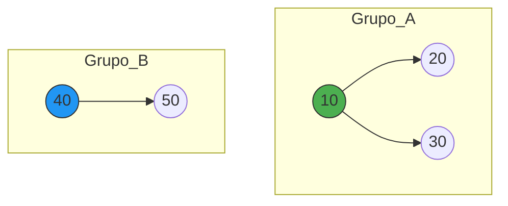
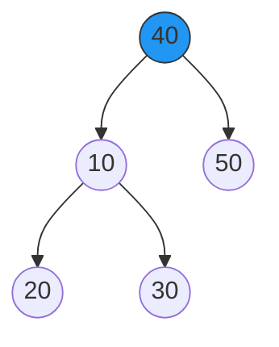
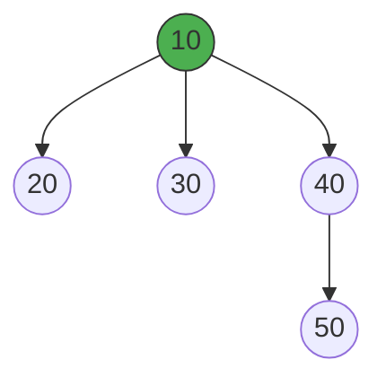
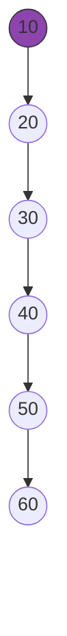
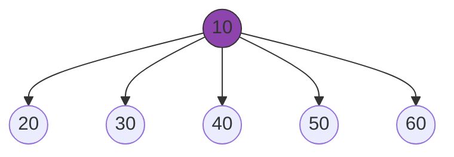

# Entendendo o Disjoint-Set (Union-Find) por Inteiro

A estrutura Disjoint-Set ADT serve para agrupar elementos em conjuntos separados e responder rapidamente a duas perguntas:

1. Dois elementos estão no mesmo grupo? (Find)
2. Como juntar dois grupos diferentes? (Union)

Se não otimizarmos essa estrutura, as árvores crescem como linhas verticais, o que torna as buscas lentas. Para resolver isso, usamos dois conceitos fundamentais baseados em árvores.

## 1. O Modelo: União por Rank (Union by Rank)

O Rank é uma estimativa da altura da sua árvore. A regra de ouro deste modelo é: a árvore mais baixa sempre se pendura na raiz da árvore mais alta. Isso impede que o grupo cresça para baixo de forma descontrolada.

**Cenário Inicial**

Temos duas redes ou grupos separados: o Grupo A (já possui mais nós e altura) e o Grupo B (um grupo menor de nós).

**O que aconteceria SEM a União por Rank?**

Se juntássemos os grupos de forma ingênua, colocando o grupo maior debaixo do menor (fazer a raiz do maior, 10, apontar para a raiz do menor, 40), a altura total do conjunto aumentaria desnecessariamente, criando caminhos longos.

**O que acontece COM a União por Rank?**

O sistema inteligente detecta que o Grupo B (raiz 40) tem menor rank do que o Grupo A (raiz 10). Portanto, o elemento 40 vira filho direto do 10. Note que a altura máxima do desenho original não mudou. O conjunto expandiu apenas para os lados (ficou horizontal):

## 2. O Modelo: Compressão de Caminho (Path Compression)

A União por Rank ajuda a segurar o crescimento, mas a Compressão de Caminho é o que realmente faz a estrutura voar. Ela acontece dinamicamente sempre que você faz uma busca (Find).

Na primeira vez que você pergunta "Quem é o líder do elemento 60?", o algoritmo faz uma viagem subindo a árvore inteira até achar a raiz. Quando ele descobre quem é a raiz, ele faz o caminho de volta atualizando o pai de todo mundo que ele visitou para apontar direto para o topo.

**Cenário Inicial (Árvore Profunda)**

Imagine uma árvore que acabou se estendendo verticalmente após várias operações. Nós acionamos a busca pelo líder do elemento 60. O algoritmo é obrigado a subir uma escada comprida de nós para chegar no topo: 60 -> 50 -> 40 -> 30 -> 20 -> 10.

**O Efeito da Compressão de Caminho**

Na viagem de volta da busca, o algoritmo reconecta cada um dos nós visitados (20, 30, 40, 50, 60) diretamente no líder supremo (10). A estrutura vertical é instantaneamente destruída e achatada:

**Por que isso resulta na Inversa de Ackermann?**

• A primeira busca pelo 60 foi "cara" (o computador teve que percorrer 5 conexões).
• No entanto, a própria busca fez uma faxina completa e achatou a árvore inteira.
• A partir de agora, qualquer busca futura por 60, 50, 40, 30 ou 20 vai custar exatamente 1 único passo.

A união por rank garante que as árvores comecem bem estruturadas, e a compressão de caminho destrói qualquer profundidade existente na primeira oportunidade de busca. É por causa desse comportamento de "autolimpeza constante" que a estrutura roda em tempo praticamente constante, crescendo de forma tão lenta que nunca passa de 4 passos no mundo real.
